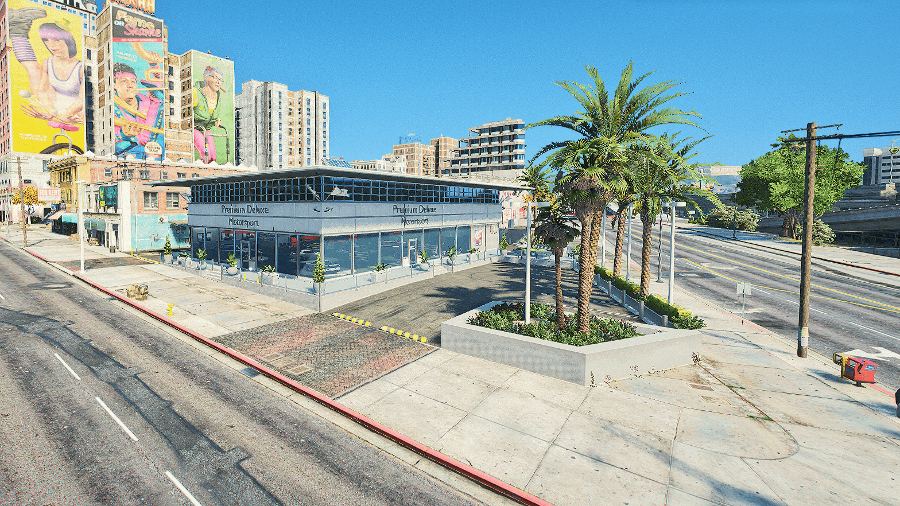

<section class="egs-hero">

<i style="--x:58%;--d:13s;--l:-2s;--dx:-12px;--s:3px;--o:0.8"></i><i style="--x:66%;--d:11s;--l:-7s;--dx:10px;--s:2px;--o:0.7"></i><i style="--x:72%;--d:15s;--l:-4s;--dx:-6px;--s:3px;--o:0.9"></i><i style="--x:80%;--d:12s;--l:-10s;--dx:14px;--s:2px;--o:0.6"></i><i style="--x:86%;--d:14s;--l:-1s;--dx:-10px;--s:3px;--o:0.75"></i><i style="--x:91%;--d:10s;--l:-6s;--dx:6px;--s:2px;--o:0.6"></i><i style="--x:63%;--d:16s;--l:-12s;--dx:8px;--s:2px;--o:0.5"></i><i style="--x:76%;--d:13s;--l:-8s;--dx:-16px;--s:2px;--o:0.7"></i><i style="--x:14%;--d:17s;--l:-5s;--dx:10px;--s:2px;--o:0.35"></i><i style="--x:30%;--d:19s;--l:-13s;--dx:-8px;--s:2px;--o:0.3"></i><i style="--x:44%;--d:18s;--l:-9s;--dx:6px;--s:2px;--o:0.35"></i><i style="--x:95%;--d:15s;--l:-3s;--dx:-8px;--s:2px;--o:0.5"></i>

<svg class="egs-frame" aria-hidden="true" focusable="false"><defs><linearGradient id="egs-fg" x1="0" y1="0" x2="1" y2="1"><stop offset="0" stop-color="#f3d58c" stop-opacity="0.8"/><stop offset="0.5" stop-color="#a47b35" stop-opacity="0.22"/><stop offset="1" stop-color="#f3d58c" stop-opacity="0.65"/></linearGradient></defs><rect width="100%" height="100%" rx="14" ry="14" stroke="url(#egs-fg)"/></svg>

Zona info

<h1>Magazin si EG Coins</h1>

EG Coins este moneda premium a serverului. Cu ea iei VIP, masini premium, bani in joc si alte pachete. Multumim ca sustii comunitatea EliteGamers!

<a class="main" href="https://elitegamers.tebex.io" target="_blank" rel="noopener">Magazin online (Tebex)</a>
<a href="https://discord.gg/elitegamers" target="_blank" rel="noopener">Intrebari pe Discord</a>

Niveluri VIP

<i></i><b>Silver</b><i></i><b>Gold</b><i></i><b>Platinum</b>

<svg class="egs-orbit" viewBox="0 0 100 100" focusable="false"><circle class="tick" cx="50" cy="50" r="48"/><circle class="line" cx="50" cy="50" r="45.5"/></svg>

<svg viewBox="0 0 200 200" focusable="false"><defs><linearGradient id="egs-cg1" x1="0" y1="0" x2="1" y2="1"><stop offset="0" stop-color="#fff4c8"/><stop offset="0.22" stop-color="#f0cc6a"/><stop offset="0.5" stop-color="#c38e2a"/><stop offset="0.72" stop-color="#f5da88"/><stop offset="1" stop-color="#8f6118"/></linearGradient><radialGradient id="egs-cg2" cx="0.38" cy="0.32" r="0.8"><stop offset="0" stop-color="#fbe8ad"/><stop offset="0.5" stop-color="#dcaa46"/><stop offset="1" stop-color="#9c6a1a"/></radialGradient><linearGradient id="egs-cg3" x1="0" y1="0" x2="0" y2="1"><stop offset="0" stop-color="#fff2c6"/><stop offset="0.55" stop-color="#e2b04c"/><stop offset="1" stop-color="#a87420"/></linearGradient><path id="egs-ring" d="M100 30 a70 70 0 1 1 -0.01 0"/><symbol id="egs-face" viewBox="0 0 200 200"><circle cx="100" cy="100" r="100" fill="url(#egs-cg1)"/><circle cx="100" cy="100" r="95" fill="none" stroke="#6e4810" stroke-opacity="0.55" stroke-width="6" stroke-dasharray="1.3 1.7"/><circle cx="100" cy="100" r="88" fill="url(#egs-cg2)" stroke="#fff1c0" stroke-opacity="0.6" stroke-width="1"/><circle cx="100" cy="100" r="80" fill="none" stroke="#6e4810" stroke-opacity="0.45" stroke-width="0.8"/><circle cx="100" cy="100" r="58" fill="none" stroke="#6e4810" stroke-opacity="0.35" stroke-width="0.6"/><text font-family="Georgia, 'Times New Roman', serif" font-size="8.5" letter-spacing="3.2" fill="#6e4810" fill-opacity="0.75"><textPath href="#egs-ring">ELITEGAMERS &#183; EG COINS &#183; ELITEGAMERS &#183; EG COINS &#183;</textPath></text><g font-family="Georgia, 'Times New Roman', serif" font-size="52" font-weight="700" text-anchor="middle"><text x="100" y="119.5" fill="#5a3a0a" fill-opacity="0.7">EG</text><text x="100" y="117" fill="#fff8e0" fill-opacity="0.75">EG</text><text x="100" y="118" fill="url(#egs-cg3)">EG</text></g><path d="M86 134 L100 130 L114 134 L100 138 Z" fill="#6e4810" fill-opacity="0.5"/></symbol></defs><use href="#egs-face"/></svg>

<svg viewBox="0 0 200 200" focusable="false"><use href="#egs-face"/></svg>

</section>
<h2>Unde cheltui EG Coins</h2>

Magazinul din joc se deschide in trei feluri:

<ul class="egs-open">
<li><b>Tasta <kbd>K</kbd></b>Meniul radial, apoi <code>Magazin in joc</code></li>
<li><b>Tasta <kbd>ESC</kbd></b>Meniul de pauza, apoi <code>Magazin din joc</code></li>
<li><b>Comanda <code>/store</code></b>Scrisa in chat</li>
</ul>
<h2>Ce poti lua cu EG Coins</h2>
<ul class="egs-buy">
<li><b>VIP</b>Silver, Gold sau Platinum, pe 30 sau 90 de zile</li>
<li><b>Bani in joc</b>Pachete de bani, direct in banca</li>
<li><b>Ore jucate</b>Pachete de la 25 la 1000 de ore</li>
<li><b>Iteme premium</b>Jante premium, antilag, sistem audio, ghiozdan premium, licenta de operator drone</li>
<li><b>Sloturi de garaj</b>+1, +3, +5 sau +10 sloturi</li>
<li><b>Sala</b>Stamina si putere la maxim</li>
<li><b>Sanctiuni</b>Iesi din admin-jail sau stergi cel mai vechi avertisment</li>
<li><b>Masini premium</b>In dealership, la categoria premium</li>
<li><b>Case si skin-uri de arme</b>Case platite in EG Coins si <a href="/general/skin-uri-arme">skin-uri premium</a></li>
</ul>
<figure class="egs-shot">

<figcaption>Dealership-ul din oras (Premium Deluxe Motorsport): aici gasesti masinile premium si pe cele VIP.</figcaption>
</figure>
<h2>Cum obtii EG Coins</h2>
<ol class="egs-earn">
<li>
<b>Din magazinul online.</b> Cumperi de pe <a href="https://elitegamers.tebex.io" target="_blank" rel="noopener">elitegamers.tebex.io</a> si treci ID-ul tau din joc. Monedele intra automat in cont, chiar daca nu esti pe server in acel moment.
</li>
<li>
<b>Din pachetul de inceput.</b> Un personaj nou primeste un EG Coin ca item. Il folosesti din inventar si intra in cont.
</li>
</ol>
<h2>VIP</h2>

Trei niveluri. Un nivel mai mare are tot ce are cel de sub el, plus ceva in plus.

<h3>VIP Silver</h3>
<ul class="egs-perks">
<li>Boost la joburi+5%</li>
<li>Salariu VIP2.000 € / ora</li>
<li>Bani la cumparare (30 zile)75.000 €</li>
</ul>

Masini VIP

<ul class="egs-cars">
<li>Ubermacht Oracle XS-LE</li>
<li>Ubermacht Sentinel 4CSL</li>
<li>Obey 9R</li>
</ul>

<h3>VIP Gold</h3>
<ul class="egs-perks">
<li>Boost la joburi+10%</li>
<li>Salariu VIP3.500 € / ora</li>
<li>Bani la cumparare (30 zile)150.000 €</li>
</ul>

Masini VIP

<ul class="egs-cars">
<li>Pegassi Reaper Custom</li>
<li>Grotti Turismo S</li>
<li>Gallivanter Baller ST-D Platinum</li>
<li>Pegassi Toros</li>
<li class="inc">+ toate masinile de la Silver</li>
</ul>

<h3>VIP Platinum</h3>
<ul class="egs-perks">
<li>Boost la joburi+15%</li>
<li>Salariu VIP5.000 € / ora</li>
<li>Bani la cumparare (30 zile)250.000 €</li>
</ul>

Masini VIP

<ul class="egs-cars">
<li>Invetero Coquette VR1</li>
<li>Benefactor Krieger</li>
<li>Pfister Comet GTS2</li>
<li>Annis Elegy RH8 FR-Works</li>
<li>Pegassi Severo Widebody</li>
<li>Pegassi Speeder <small>(barca)</small></li>
<li>Sparrow <small>(elicopter)</small></li>
<li class="inc">+ toate masinile de la Gold</li>
</ul>

<ul class="egs-common">
<li>Suport</li>
<li>Grad VIP pe Discord si in joc</li>
<li>Salariul VIP intra in banca, la fiecare ora</li>
<li>Pachetul de 90 de zile da mai multi bani la cumparare</li>
<li>Acelasi nivel cumparat din nou adauga zilele la cele ramase</li>
</ul>

Masinile VIP le iei gratis din dealership, cate una din fiecare model, cat timp ai VIP-ul. Barca o gasesti la dealership-ul de barci, elicopterul la cel de avioane. Daca VIP-ul expira, nu le mai poti scoate din garaj pana nu il reactivezi.

<h2>Sanctiuni si unban</h2>

Ai primit ban temporar sau permanent si vrei sa platesti ridicarea lui? Pe Tebex gasesti <b>Unban temporar</b>, <b>Unban permanent</b> si <b>Clear warn</b>.

<ul class="egs-steps">
<li><b>Inainte sa cumperi, deschide un ticket pe <a href="https://discord.gg/elitegamers" target="_blank" rel="noopener">Discord</a>.</b> Echipa iti spune daca sanctiunea ta se poate ridica.</li>
<li>Unban-ul nu se scoate automat, este nevoie sa deschizi un ticket inainte de a cumpara.</li>
<li>Unban-ul temporar ridica doar un ban temporar. Pentru un ban permanent iei Unban permanent.</li>
</ul>

<b>Atentie:</b> respectarea regulamentului FiveM e obligatorie. Daca primesti <b>ban fara drept de plata</b>, pachetele cumparate nu se mai pot folosi.

Ai intrebari? Echipa te asteapta pe <a href="https://discord.gg/elitegamers" target="_blank" rel="noopener">Discord</a>.

